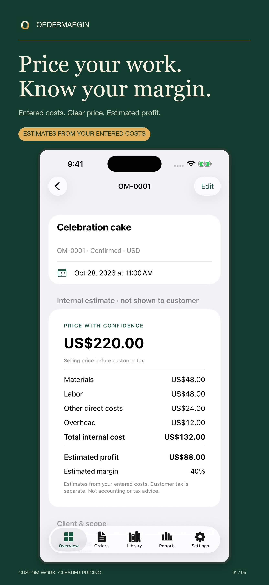

# OrderMargin: Custom Quotes

Source-free public showcase for production app #21. A native iPhone/iPad workflow for solo custom-order businesses: materials, labor, overhead, estimated pricing/profit, customer quotes, deposits and balances. No account or developer-operated backend. Multiple currencies; no exchange-rate conversion.

Status: app1.0(1), Annual Pro, Lifetime Pro and subscription group jointly submitted October23,2026. Apple confirms four items submitted; app Waiting for Review. Not yet approved or publicly released. TestFlight is skipped by publisher instruction; meaningful production QA remains required. Native source, tests, signing and private evidence belong to a separate private repository and are not included here.

Free includes three active orders, basic calculations, manual payments, a Classic PDF, material library and safety backups. Annual/Lifetime Pro add unlimited active orders, order/labor templates, branding, advanced reports, CSV and premium styling. Actual localized purchase prices are displayed by StoreKit in the app. Estimates depend on entered costs; this is not accounting, tax or payment-processing software.

[Workflow and support](https://sepidehdalir.github.io/ordermargin/support.html) · [Privacy](https://sepidehdalir.github.io/ordermargin/privacy.html)

The original identity artwork is code-drawn. Marketing assets will use authentic app UI and actual customer PDFs with fictional example businesses/clients. No competitor artwork or demand claims.

## Product tour

Five dedicated iPhone and five dedicated iPad marketing frames show the final native interface and an actual exported quote, using fictional example records. Branding and Atelier styling are labelled Pro.

[View the complete product tour and support guide](https://sepidehdalir.github.io/ordermargin/).

Release status: **Waiting for Review; not released**. Physical native tests passed23/23. The publisher separately reports genuine Apple-explicit Sandbox purchase/restore and requested workflows passed. No Apple approval, public release, demand or revenue claim.
